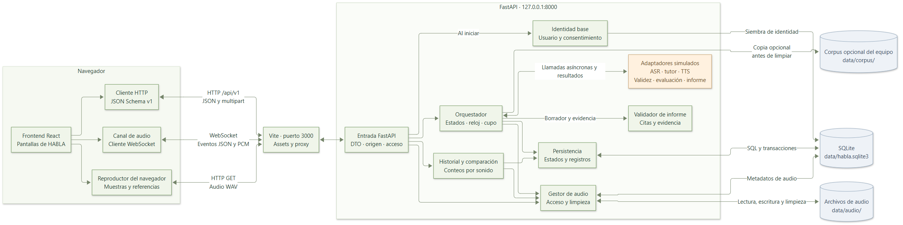

# ¡Habla!

Proyecto de Sistemas Inteligentes para practicar conversación en inglés con un tutor de voz. Al terminar, el estudiante recibe un informe en español con observaciones de pronunciación, gramática y vocabulario sustentadas en la sesión.

## Qué puedes probar

La plataforma de la iteración 1 funciona en local con datos sintéticos. Elige nivel, tema y duración, simula una conversación de 5 o 10 minutos y completa las cinco frases ancla para ver el informe. Desde **Mis sesiones** puedes volver a los informes y escuchar las muestras disponibles. En **Comparar** puedes revisar dos sesiones compatibles por sonido. [Perfil C-09](docs/architecture/CONTRACTS.md#c-09-perfil-de-la-iteración-1)

La captura por micrófono y la integración de los modelos de voz y evaluación se abordarán con Nicolás e Ivan en G1/G2. [Plan por iteraciones](docs/ROADMAP.md)

## Componentes y conectores

[](docs/architecture/COMPONENTS.svg)

Haz clic en el diagrama para ampliarlo.

1. **Interfaz y proxy.** React muestra la práctica, el informe y el historial. Vite sirve la interfaz en el puerto `3000` y reenvía las solicitudes de `/api/v1` a FastAPI en el puerto `8000`.
2. **HTTP y WebSocket.** Por HTTP, la interfaz consulta datos JSON y sube las muestras de las frases ancla. El navegador también pide los WAV de muestras y referencias por HTTP. El WebSocket lleva los eventos y el audio PCM de la conversación.
3. **Orquestación e informe.** El orquestador controla el estado y el reloj de la práctica y coordina los adaptadores simulados de voz y evaluación. Entrega el borrador y su evidencia al validador y publica el informe tras limpiar el audio temporal.
4. **Almacenamiento e historial.** SQLite guarda el estado de las sesiones, los informes y los metadatos de audio. El gestor de audio guarda las muestras disponibles en `data/audio/` por defecto. Si el equipo activa el corpus, el orquestador archiva una copia de la sesión antes de limpiar.

[Correspondencia con el código](docs/architecture/ARCHITECTURE.md#correspondencia-con-el-código) · [Fuente editable en Mermaid](docs/architecture/COMPONENTS.mmd)

## Arranque local

Requiere Python 3.12, uv, un navegador de escritorio y Node.js 22.12 o posterior de la serie 22, o Node.js 24 en adelante. [Instalar uv](https://docs.astral.sh/uv/)

### Instala las dependencias

Ejecuta estos comandos desde la raíz del repositorio clonado, donde están `package.json` y `pyproject.toml`.

```sh
uv sync --locked --python 3.12
npm ci
```

Si PowerShell bloquea `npm.ps1`, usa `npm.cmd` en los comandos de npm.

### Terminal 1 · API

Inicia el backend desde la raíz del repositorio y deja abierta la terminal.

```sh
uv run --locked python -m uvicorn habla.app:app --host 127.0.0.1 --port 8000 --ws-max-size 8192
```

### Terminal 2 · Web

Abre otra terminal en la misma carpeta e inicia el frontend.

```sh
npm run dev
```

Abre la práctica en el navegador. La banda superior indica el modo de simulación y los botones generan los turnos y las muestras. La sonda de la API comprueba también el proxy de Vite.

[Abrir la práctica](http://127.0.0.1:3000/practica) · [Ver mis sesiones](http://127.0.0.1:3000/sesiones) · [Comprobar la API](http://127.0.0.1:3000/api/v1/health)

### Simula un fallo

Para simular el rechazo de tres muestras de una frase ancla, detén la API si está activa y arráncala en PowerShell con el escenario `anchor_invalid`. [Escenarios de demostración](docs/architecture/ADR-003-fixture-operation.md)

```powershell
$env:HABLA_MODE = "demo"
$env:HABLA_DEMO_SCENARIO = "anchor_invalid"
uv run --locked python -m uvicorn habla.app:app --host 127.0.0.1 --port 8000 --ws-max-size 8192
```

## Comprobaciones

```sh
uv run --locked pytest
npm test
npm run build
```

Los fixtures y el esquema compartido permiten probar productores y consumidores sin GPU. [Fixtures v1](contracts/fixtures/platform-v1.json) · [Esquema compartido](contracts/v1.json) · [Evidencia de verificación](docs/verification/PLATFORM-ITERATION-1.md)

## Documentación

- Alcance del MVP y criterios de aceptación. [Requisitos](docs/REQUIREMENTS.md)
- Hitos, reparto del trabajo y alcance de la demo del *Shark Tank*. [Plan por iteraciones](docs/ROADMAP.md)
- Módulos, contratos compartidos y etapas de integración. [Especificaciones](docs/specs/README.md)
- Stack y decisiones de arranque local. [ADR-001](docs/architecture/ADR-001-local-development.md)
- Qué se mide, cómo y con qué responsables. [Métricas de evaluación](docs/experiments/METRICS.md)
