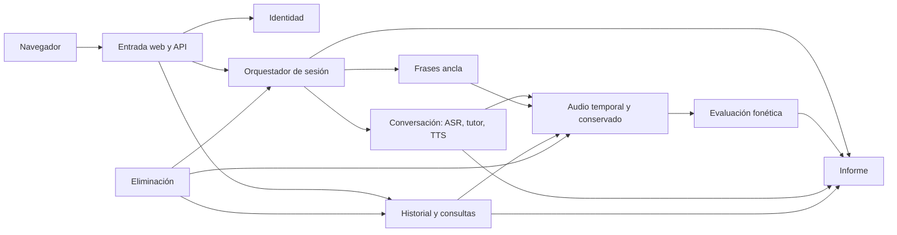
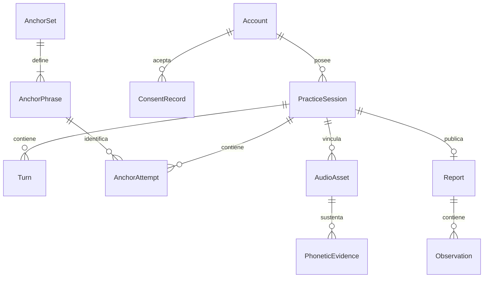

# Arquitectura del MVP de ¡Habla!

**Estado:** propuesta de diseño, versión 1.0, 2026-10-29. **Custodio:** persona A; revisión de B y C.

Este documento y [CONTRACTS.md](CONTRACTS.md) definen la base compartida de las [specs](../specs/README.md). Son borradores revisables; se convierten en referencia normativa de implementación al superar G0. Los requisitos confirmados en [REQUIREMENTS.md](../REQUIREMENTS.md) conservan su autoridad sobre el alcance. No hay arquitectura implementada ni tecnologías aprobadas.

## 1. Límites y estilo propuestos

Un cliente web y un backend modular, con ejecución de modelos en tareas separadas de la atención HTTP y del audio en tiempo real. Se propone una sola unidad de despliegue de aplicación y un proceso de inferencia cuando lo exija el aislamiento de GPU; los módulos lógicos no implican microservicios, bases separadas ni un broker.

Las flechas representan colaboración mediante interfaces; no conceden acceso directo al almacenamiento privado de otro módulo. El flujo acústico debe continuar aunque haya evaluación pendiente. Cada implementación de almacenamiento y cola podrá reemplazarse sin cambiar los DTO compartidos.

## 2. Autoridad y límites de escritura

| Módulo | Spec | Responsable | Datos y decisiones que posee |
| --- | --- | --- | --- |
| Base, shell y contratos | SPEC-00 | A; B/C revisan | Configuración compartida, registro de rutas y contratos; no datos de negocio |
| Experimentos | SPEC-01 | C | Manifiestos de datos, particiones, calibraciones, resultados y ADR del evaluador |
| Contenido | SPEC-02 | B; C revisa | Niveles, temas, objetivos, cinco frases y referencias estadounidenses versionadas |
| Identidad | SPEC-03 | A | Cuenta, hash, sesión autenticada, autorización y bloqueo de cuenta |
| Orquestación | SPEC-04 | A | Estado y versión de sesión de práctica, reloj, ocupación, operación recuperable |
| Conversación | SPEC-05 | B | Turnos, transcripción, generación y reproducción del tutor |
| Audio y consentimiento | SPEC-06 | A; B/C consumen | Consentimiento, metadatos y bytes, vencimiento, accesibilidad y limpieza |
| Frases ancla | SPEC-07 | B | Intentos, orden, resultado de validez; consulta el catálogo |
| Evaluación fonética | SPEC-08 | C | Evidencia acústica, cobertura y versión del evaluador; no decide estado global |
| Informe | SPEC-09 | C | Informe final, observaciones, referencias de evidencia y publicación |
| Historial y comparación | SPEC-10 | A | Proyección de lectura y comparación; consulta las fuentes autoritativas |
| Eliminación | SPEC-11 | B | Operación de borrado y coordinación; cada módulo elimina sus propios datos |
| Aceptación y operación | SPEC-12 | A/B/C | Configuración de demo, mediciones y expediente de aceptación |

Compartir una base de datos es válido; las tablas siguen teniendo un solo escritor lógico. Las consultas entre módulos pasan por interfaces o proyecciones identificadas. No introducir escritura cruzada desde el frontend ni desde el worker.

## 3. Invariantes y estados

Estado global de práctica, autoridad de SPEC-04:

| Estado | Entrada | Salida permitida y condición |
| --- | --- | --- |
| `ready` | Creación con identidad, configuración, consentimiento y cupo válidos | `conversation` al iniciar audio; `incomplete` al cancelar/abandonar |
| `conversation` | `conversation_started_at` fijado una sola vez | `anchors` al vencer la duración; `recoverable_error` ante fallo recuperable; `incomplete` por cancelación |
| `anchors` | Cierre de charla; no nuevos turnos conversacionales | `processing` tras cinco muestras válidas; `recoverable_error`; `incomplete` al agotar intentos/cancelar |
| `processing` | Snapshot de cinco muestras válidas y charla cerrada | `completed` al publicar informe válido; `recoverable_error`; `incomplete` por cancelación |
| `recoverable_error` | Se guarda `resume_state`, operación e intentos de recuperación | Estado anterior tras el único reintento manual exitoso; `incomplete` si falla, vence el plazo o se cancela |
| `completed` | Informe publicado y temporales inaccesibles, con limpieza física confirmada antes de finalizar la operación | Solo eliminación; no reanuda grabación |
| `incomplete` | Motivo terminal registrado y temporales revocados | Solo eliminación; no puede publicar informe |

Se propone conservar cupo desde `ready` hasta `processing`, incluyendo error recuperable, para evitar solapamiento de trabajos GPU y cierre. Esto es más conservador que una sola conversación de voz y debe revisarse en G0; el historial permanece disponible.

- Una transición compara `state_version`; duplicados no repiten efectos. La sesión y el cupo se actualizan de forma atómica o mediante una operación durable equivalente.
- El reloj de conversación es del servidor y monotónico para el cálculo; se guardan instantes UTC para presentación. Pausas y errores consumen tiempo de charla. Recuperar no reinicia el reloj; si ya venció, se cierra hacia `anchors`.
- Una recarga o nuevo canal no reanuda una práctica anterior. El backend detecta abandono por lease/heartbeat; antes de crear otra práctica del mismo usuario termina y limpia la anterior. Los plazos son decisiones de G0/G1 y no latencias prometidas del producto.
- Cancelar o eliminar gana frente a una publicación tardía: un trabajo solo publica si coinciden propietario vigente, `state_version`, `deletion_epoch` y estado permitido.
- Borrar audio tras un informe conserva el texto del informe. Borrar sesión/cuenta elimina también sus textos. La revocación de acceso precede a la limpieza física.
- Cero observaciones no significa pronunciación perfecta. Evidencia ausente o dudosa se identifica como no evaluada.

## 4. Datos y relaciones lógicas

Esquema conceptual; no obliga a un ORM. `Report` solo existe públicamente si está publicado; resultados intermedios no son informes del historial. Las referencias generadas desde un recorte personal también son privadas y comparten su ciclo de vida; solo las referencias del catálogo son públicas. El registro de eliminación podrá sobrevivir temporalmente sin correo, texto, audio ni identificadores de proveedores, solo para terminar la limpieza; su política se fija en SPEC-11.

## 5. Frontend y propiedad de pantallas

B integra navegación y componentes compartidos; A entrega formularios de cuenta mediante las interfaces de B y C entrega la vista de informe con el mismo shell. Rutas propuestas: `/registro`, `/ingresar`, `/practica`, `/sesiones`, `/sesiones/:id`, `/comparar`, `/cuenta`. La ruta de práctica muestra configuración, permiso de micrófono, consentimiento, conversación, frases, espera y fallo como estados de un mismo flujo.

No se permite que varios módulos instalen routers o manejadores de autenticación distintos. Las cadenas visibles y errores explicables están en español; el texto de tutor y frases en inglés. Controles con etiquetas, foco visible, operación por teclado y estados anunciables; las comprobaciones concretas pertenecen a cada spec.

## 6. Entrada, proxy y configuración

Propuesta de G0: origen único; desarrollo web `127.0.0.1:3000`, backend `127.0.0.1:8000`, canal bajo `/api/v1/practices/:id/stream` y API bajo `/api/v1`. El servidor web reenvía esas rutas al backend, con soporte de actualización de canal. La inferencia, si usa otro proceso, solo es interna y su puerto se declara en configuración de servidor.

Son valores propuestos, todavía no instrucciones ejecutables. SPEC-00 confirma puertos, comandos, variables y transporte en ADR-001 antes de implementar clientes reales. El MVP se ejecuta en local (D-13): en `localhost` el navegador permite el micrófono sin HTTPS. Si se accede desde otro equipo por red, entrada HTTPS y canal cifrado. El despliegue en la nube queda para V2. Credenciales de servicios solo en servidor. No registrar contraseñas, cookies, textos completos ni audio en telemetría de operación.

## 7. Decisiones y límites de tecnología

| ADR a producir | Custodio | Debe resolver | Gate |
| --- | --- | --- | --- |
| ADR-001 | A con B/C | Lenguajes, web/backend, persistencia, canal, codificación de audio, puertos, scripts, autenticación y ejecución de tareas | G0 |
| ADR-002 | C con A/B | Evaluador, evidencia disponible, costos, licencias, confianza, validez y versión compatible | G1 para usar modelo real; selección final G3 |
| ADR-003 | A con B/C | Lease/heartbeat, deadlines, límites de carga, limpieza física y comportamiento ante reinicio | G1 |
| ADR-004 | B con C | Catálogo de frases/referencias, guía del tutor, parte de TTS no escuchada | G1 |

Opciones a estudiar: web con componentes y backend HTTP; persistencia relacional; almacenamiento privado local para la demo; tareas internas con cola acotada. El 2026-10-30 el equipo aceptó como orientación FastAPI (Python) en el backend y React con Vite en el frontend; ADR-001 la formaliza. No se selecciona proveedor por insinuación. Pesos abiertos y las GPU locales del grupo (RTX 4090/5090 y 2× RTX 5060 de 16 GB) son orientación del catálogo; compatibilidad, memoria y acceso deben medirse. No hacen falta servicios distribuidos para cumplir estos contratos.

## 8. Protocolo para modificar contratos

Quien posee un contrato propone el cambio y actualiza las specs afectadas. Sus consumidores B/C/A revisan ejemplos y pruebas de contrato antes de integrarlo. Durante una etapa se agregan campos opcionales compatibles; renombrar, quitar campos o cambiar semántica requiere nueva versión y migración acordada. Los archivos compartidos tienen un custodio; los demás aportan cambios en revisiones pequeñas. El flujo de trabajo está en [el plan de specs](../specs/README.md).
