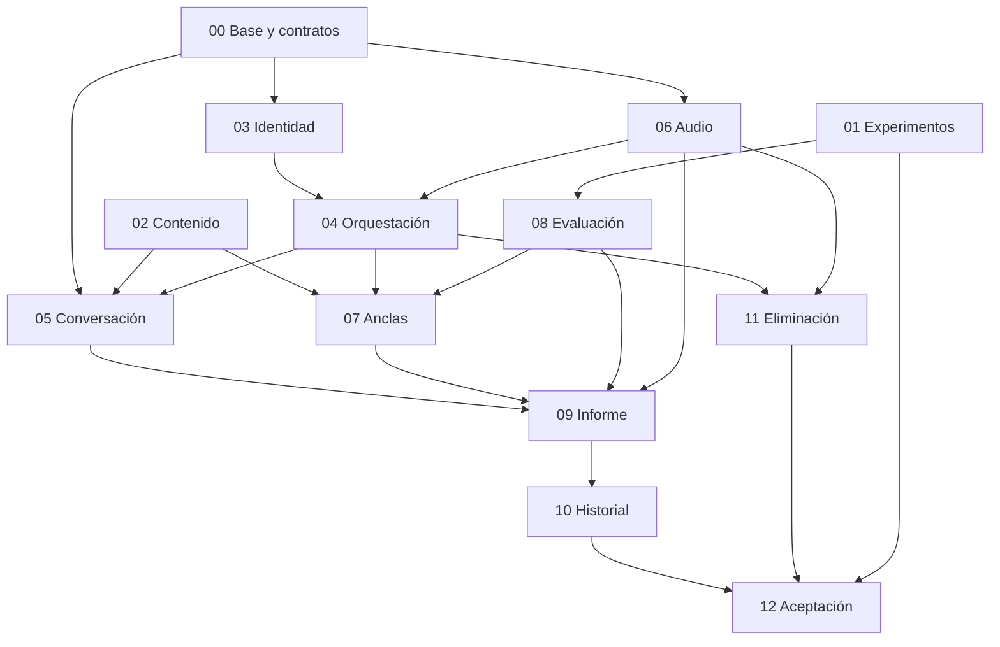

# Plan de construcción por especificaciones

**Producto:** ¡Habla! — MVP del [catálogo](../REQUIREMENTS.md). **Fecha:** 2026-10-29. **Estado:** propuesta de planificación para tres personas; todas las specs están en borrador y no hay implementación.

Este es el punto de entrada al trabajo de construcción. El README raíz presenta el producto; aquí se organizan su ejecución, dependencias y aceptación. La especificación guía contratos, implementación y pruebas; una tarea termina al satisfacer sus criterios con evidencia, no al producir código.

## 1. Cómo leer y aprobar el paquete

1. Leer este plan y los requisitos relevantes del catálogo.
2. Revisar [arquitectura](../architecture/ARCHITECTURE.md) y [contratos](../architecture/CONTRACTS.md) antes de implementar integraciones.
3. Tomar una spec, cerrar sus preguntas bloqueantes para el gate correspondiente e implementar escenarios con fixtures compartidos.
4. Integrar al pasar sus contratos y registrar las pruebas y límites. Las casillas continúan pendientes hasta disponer de evidencia.

Se usó la primera variante del template recibido: once secciones con contratos, propiedad de datos y verificación. La segunda contenía supuestos de frontend dummy y backend inexistente de otro contexto. No se trasladan rutas de código, citas de reuniones ni acuerdos no disponibles. Las tecnologías continúan como propuestas hasta sus ADR.

**Autoridad:** catálogo para alcance confirmado; ADR aceptado y contratos congelados para diseño; spec para comportamiento y aceptación del módulo. Si se contradicen, corregir los documentos antes de implementar. Un contrato propuesto no se presenta como decisión del equipo.

## 2. Notación, identificadores y prioridades

Se conserva `RF-01..RF-20`, `RNF-01..RNF-14`, `RT-01..RT-07` y `D-*` del catálogo. Cada descomposición usa `SNN-RF-MM`; sus escenarios usan `SNN-CA-MM` y sus preguntas `SNN-P-MM`. No renumerar IDs al reordenar texto. La [matriz de trazabilidad](TRACEABILITY.md) asigna responsables primarios y colaboradores.

Se usa [EARS, de Alistair Mavin](https://alistairmavin.com/ears/), con palabras clave traducidas al español: invariantes «EL SISTEMA DEBE…»; eventos «CUANDO…, EL SISTEMA DEBE…»; estados «MIENTRAS…, EL SISTEMA DEBE…»; situaciones no deseadas «SI…, ENTONCES EL SISTEMA DEBE…». Cuando haga falta combinar estado y evento, mantener primero la precondición y luego el disparador. Cada requisito identifica una respuesta observable y se comprueba con Dado/Cuando/Entonces.

P1 significa necesario para aceptar este MVP. Las trece specs son P1 porque todas aportan requisitos obligatorios o soporte indispensable; P1 no significa que se hagan simultáneamente. El orden está en etapas/gates. No se incorporan funciones opcionales como P2 para aparentar una segunda etapa de producto.

Esfuerzo S/M/L es relativo, no una promesa de días: S una pieza acotada; M varias piezas conocidas; L integración con incertidumbre o múltiples subsistemas. Las specs L se ejecutan en los hitos de las etapas, sin convertirlas en una única entrega final.

## 3. Catálogo de specs

| Spec | Resultado | Responsable propuesto | Etapa | Esfuerzo |
| --- | --- | --- | --- | --- |
| [SPEC-00](SPEC-00-foundations-and-contracts.md) | Base del proyecto y contratos compartidos | A; revisión B y C | E0 | M |
| [SPEC-01](SPEC-01-experiments-and-evaluator-selection.md) | Protocolo experimental y selección del evaluador | C; A revisa operación y B contenido | E0–E3 | L |
| [SPEC-02](SPEC-02-content-and-catalog.md) | Catálogo pedagógico, frases y referencias | B; revisión acústica de C | E0–E1 | M |
| [SPEC-03](SPEC-03-identity-and-access.md) | Cuentas, autenticación y acceso propio | A; B integra formularios | E1 | M |
| [SPEC-04](SPEC-04-session-orchestration.md) | Sesiones, reloj, cupo y recuperación | A; B integra estados y C trabajos | E1 mínimo; E2 completo | L |
| [SPEC-05](SPEC-05-voice-conversation.md) | Conversación, transcripción e interrupciones | B; C asesora modelos y A canal | E1–E2 | L |
| [SPEC-06](SPEC-06-audio-and-consent.md) | Consentimiento y ciclo de vida del audio | A; B integra consentimiento y C consume audio | E1–E2 | L |
| [SPEC-07](SPEC-07-anchor-phrases.md) | Lectura y validación de las cinco frases ancla | B; C entrega validador | E2 | M |
| [SPEC-08](SPEC-08-phonetic-evaluation.md) | Evaluación acústica, validez y evidencia fonética | C; A revisa aislamiento y B consume validez | E1–E2 | L |
| [SPEC-09](SPEC-09-final-report.md) | Informe sustentado de pronunciación, gramática y vocabulario | C; B integra presentación | E2 | L |
| [SPEC-10](SPEC-10-history-and-comparison.md) | Historial propio y comparación por sonido | B; A/C proveen consultas | E3 | M |
| [SPEC-11](SPEC-11-data-deletion.md) | Eliminación de audio, sesiones y cuenta | A; B integra acciones y C cancela trabajos | E3 | L |
| [SPEC-12](SPEC-12-acceptance-and-demo.md) | Integración, despliegue y aceptación de la demo | A: despliegue; B: recorridos; C: métricas | E3 | M |

## 4. Equipo y propiedad

A/B/C son roles de planificación; asignar nombres reales al iniciar E0. No implican tres agentes automáticos ni una asignación ya acordada.

| Persona | Área principal | Entregables | Revisión que aporta |
| --- | --- | --- | --- |
| A | Plataforma y datos | Base, identidad, orquestación, audio, eliminación y operación | Permisos, persistencia, carreras y configuración de módulos de B/C |
| B | Experiencia y voz | Catálogo, shell, conversación, anclas, historial y comparación | Usabilidad, canal, contratos de pantalla y contenido pedagógico |
| C | Evaluación | Experimentos, validador/evaluador, análisis lingüístico e informe | Evidencia, cobertura, versiones y mediciones |

Cada área entrega frontend/adaptadores que le correspondan; B mantiene router y componentes compartidos. A custodia API/proxy/configuración; C custodia DTO de evidencia e informe. B puede implementar la vista de informe a partir del DTO de C para descargar trabajo de C, manteniendo un único editor de esa vista por tarea.

La carga de A y C es alta: usar WIP de una tarea principal por persona, reservar bloques de GPU y revisar capacidad tras G1. B puede apoyar contratos UI y pruebas de integración mientras C mide, y preparar casos de borrado mientras A implementa la coordinación. Ajustar reparto tras mediciones, sin cambiar propietarios de datos a mitad de una integración.

## 5. Etapas y gates de integración

No se fijan fechas de calendario ni duración sin conocer disponibilidad del equipo. «Antes de G1» es una fecha objetivo relativa verificable; al iniciar E0 el equipo asigna fechas reales al tablero.

| Etapa | A: plataforma | B: experiencia | C: evaluación | Entrega y condición de salida |
| --- | --- | --- | --- | --- |
| E0 — Definir y reducir incertidumbre | SPEC-00: ADR-001, shell/API, esquemas, fixtures y spike conjunto de canal | SPEC-02: esquema de contenido, borrador de fichas/frases; aporta captura/shell al spike | SPEC-01: protocolo, acceso/licencias, evidencia fixture y prueba inicial de GPU | G0: contrato v1 revisado por productores/consumidores, stack/puertos/perfil de audio fijados y base local reproducible |
| E1 — Bases y un turno real | SPEC-03; SPEC-06 consentimiento/temporales/lectura; mínimo de SPEC-04 para crear/iniciar/cancelar con cupo | SPEC-05 con fixtures y luego un turno real; cerrar SPEC-02 | SPEC-01 calibración inicial y SPEC-08 validez/adaptador mínimo | G1: cuenta→consentimiento→captura→un turno hablado real→cancelación/limpieza; frases/políticas y deadlines cerrados para integración real |
| E2 — Sesión completa | Completar SPEC-04; SPEC-06 recortes, expiración y limpieza; barrera de borrado preparada | Completar SPEC-05; SPEC-07 con validador real; integrar vista de informe | Completar SPEC-08 y SPEC-09 con referencias y citas verificables | G2: conversación cronometrada→cinco anclas→informe real y temporales borrados; cancelación/fallo no publican informe |
| E3 — Producto verificable | SPEC-11 completo; SPEC-12 despliegue, reinicios, inventario y permisos | SPEC-10 y SPEC-12 recorridos, comparación y UI | SPEC-01 evaluación final congelada; SPEC-12 métricas/limitaciones | G3: ocho criterios del catálogo verificados, expediente real y limitaciones explícitas; pendientes críticos impiden declarar MVP aceptado |

Los gates incluyen una revisión breve de los tres: contratos, criterios y evidencia. G0 congela forma de DTO, no el modelo fonético. G1 habilita audio/modelos reales con consentimiento y criterios calibrados. El adaptador puede cambiar tras comparación sin romper DTO. G2 acredita un recorrido, no toda la demo. G3 acepta o identifica con precisión los criterios incumplidos.

La base mínima de SPEC-04 en E1 evita probar audio real sin práctica/cupo/consentimiento; su máquina y recuperación completas se cierran en E2. El permiso local de micrófono puede probarse antes, descartando muestras sin enviarlas. Ningún hito permite saltarse controles para una demo rápida.

## 6. Dependencias y trabajo paralelo

Las flechas son condiciones de integración real, no espera hasta terminar cada spec por completo. 01 y 02 arrancan con 00 y solo congelan la forma de sus datos en G0. 03/06 entregan una primera base; 04 entrega create/start/cancel antes del flujo completo. 05/07/09/10 pueden construirse con C-08 antes de recibir productores reales. La evaluación final de 01 consume resultados de 08/09 en E3: es realimentación experimental planificada, no una dependencia circular que impida comenzar.

**Camino crítico funcional:** contratos → identidad/audio/cupo mínimos → voz → anclas válidas → informe/publicación/limpieza → historial/comparación y aceptación.

**Camino crítico experimental:** acceso/licencias/GPU → protocolo/particiones → calibración/validez → adaptador real → métricas congeladas. Una API externa inaccesible se documenta como limitación conforme al catálogo; no se fabrica una comparación ni se bloquea el resto de áreas sin necesidad.

## 7. Acuerdo de colaboración

- Cada tarea declara spec, criterios que resuelve, archivos que posee y contrato que consume. Mantener ramas y revisiones pequeñas; integrar con frecuencia al superar contrato, no acumular tres ramas enormes hasta E3.
- El custodio edita archivos compartidos (router, esquemas, configuración, migraciones coordinadas). Los demás proponen cambios revisables; así se evitan ediciones concurrentes de la misma pieza.
- Un cambio de DTO se revisa con consumidores, actualiza ejemplos y pasa pruebas de contrato antes de integrar. No introducir endpoints, estados o campos alternativos en una spec para sortear una pregunta bloqueante.
- Cada módulo posee su almacenamiento y expone DTO/interfaces. La persona que construye una pantalla no escribe tablas de otro módulo.
- Repetición de transporte, repetición de grabación y recuperación manual son conceptos distintos. Se prueban con IDs y claves compartidos; no se implementan tres contadores independientes para el mismo propósito.
- Reservar ventanas del servidor GPU para C y ensayos de voz de B. Los fixtures permiten avanzar fuera de esas ventanas y se identifican siempre como simulados.
- Al cambiar una spec, revisar la matriz y sus consumidores. Si cambia alcance confirmado, registrar la decisión del equipo y actualizar requisitos; no hacerlo por conveniencia de implementación.

## 8. Definición de preparada y terminada

Una spec está **preparada para su hito** cuando tiene responsable, escenarios, contrato congelado del hito, fixtures y preguntas bloqueantes de ese hito resueltas. Puede tener preguntas experimentales futuras explícitas sin impedir el trabajo independiente.

Está **terminada** cuando sus criterios tienen evidencia, pruebas de contrato/integración pertinentes pasan, permisos/fallos/cancelación aplicables están verificados, documentación refleja la implementación y los consumidores pueden integrarse. Un README, mock o salida de modelo no validada no acredita los criterios del producto.

Un requisito sigue **pendiente** si su prueba no se ejecutó. Registrar fallos y límites; no cambiar una casilla a aprobada porque existe código. SPEC-12 verifica el producto integrado, sin sustituir las pruebas de los módulos.

## 9. Decisiones abiertas y límites de la planificación

| Decisión | Responsable | Fecha objetivo | Bloquea | Trabajo que puede continuar |
| --- | --- | --- | --- | --- |
| Stack, estructura, sesión web, canal, perfil/cabecera de audio y puertos | A con B/C | G0 | Implementación incompatible de base/clientes | Protocolo y borradores de contenido |
| Textos de cinco anclas, referencias y quince fichas | B con C | G1 | Validación/comparación reales | UI y DTO fixture |
| Política detallada del tutor y parte TTS no escuchada | B con C | G1; casos temáticos completos G2 | Aceptación del tutor | Transporte y UI con fixtures |
| Motor preliminar, datos/licencias, validez y confianza | C | G1 | Adaptador acústico real | Plataforma y consumidor de evidencia fixture |
| Consentimiento, procesadores externos si aplican | A con B/C | G1, antes de usar voz real | Captura persistida/procesamiento real | Preflight local sin envío y fixtures |
| Deadlines, lease, límites de audio/recorte y limpieza física | A con B/C | G1 | Recuperación, almacenamiento y trabajos reales | Contratos/algoritmos con reloj/configuración fixture |
| Modelos de tutor/TTS y gramática/vocabulario | B/C | G1 | Voz/análisis lingüístico reales | Adaptadores y citas fixture |
| Umbrales finales de latencia y protocolo/calidad lingüística | C con A/B | Protocolo antes de medir; valores finales G3 | Declarar aceptación de esos criterios | Implementación y mediciones exploratorias |
| Presupuesto, conexión, navegador/red y calendario | A/B/C | Fechas al iniciar E0; entorno antes de G3 | Demo reproducible y compromisos de fecha | Desarrollo local declarado |

Las preguntas locales `SNN-P-MM` precisan estos bloqueos. No hay selección tecnológica aprobada, citas de reuniones disponibles ni resultados experimentales en este paquete. La especificación de contenido incluye resolver los límites temáticos de la propuesta original: la URL externa no fue accesible durante la preparación; se conserva el catálogo existente como fuente y se marca la precisión pendiente.
